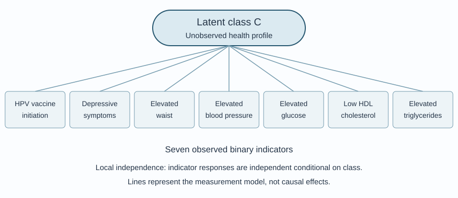
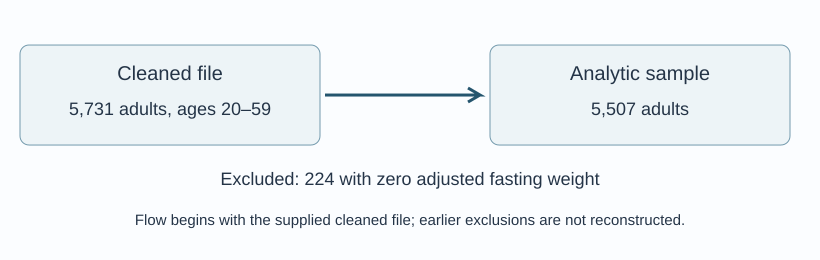
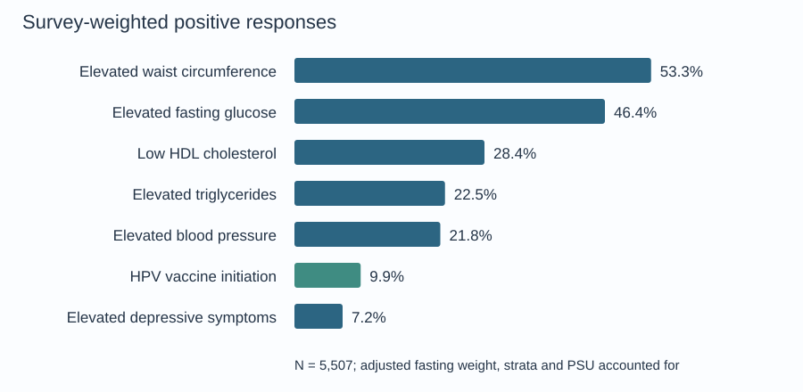

## Introduction

Human papillomavirus (HPV) vaccination is an effective strategy for
preventing new HPV infections and HPV-associated cancers. In the United
States, catch-up vaccination is recommended for all persons through age
26 years, whereas vaccination for adults aged 27--45 years is based on
shared clinical decision-making; HPV vaccines are not licensed for use
after age 45 years [@CDC2024; @meites2019human]. These boundaries make
age particularly relevant when adult vaccination patterns are examined.
Nevertheless, HPV-vaccination coverage among U.S. adults remains
incomplete and varies across demographic and health-care-access groups
[@lewis2022disparities; @lu2021surveillance]. HPV vaccination may
therefore reflect not only receipt of a specific cancer-prevention
intervention but also broader differences in access to and engagement
with preventive care.

Metabolic syndrome (MetS) is a cluster of five cardiometabolic
abnormalities: central adiposity, elevated triglycerides, reduced
high-density lipoprotein cholesterol, elevated blood pressure, and
impaired glucose regulation [@alberti2009harmonizing]. MetS is common
among U.S. adults, increases markedly with age, and is associated with
elevated cardiovascular and all-cause mortality risk
[@hirode2020trends; @mottillo2010metabolic]. Although MetS is
conventionally defined by the presence of any three of its five
components, a binary diagnosis treats individuals with different
constellations of abnormalities as equivalent
[@alberti2009harmonizing]. Retaining the individual components may
therefore provide a more informative account of heterogeneity in
cardiometabolic risk.

Depressive symptoms add a clinically important mental-health dimension
to this heterogeneity. Meta-analytic evidence supports an association
between depression and MetS, including evidence that the relationship
may be bidirectional and that individual MetS components differ in
their associations with depressive symptoms [@kim2023association;
@pan2012bidirectional]. However, research on HPV vaccination,
depressive symptoms, and metabolic health has largely developed along
separate lines. Evidence directly addressing depressive symptoms in
relation to adult HPV-vaccination patterns is limited. The closest
related NHANES research evaluated MetS in relation to HPV infection
rather than vaccination and represented MetS primarily as an overall
diagnosis [@molokwu2017association]. Consequently, little is known about
whether HPV vaccination, depressive symptoms, and component-specific
metabolic abnormalities form distinct patterns within the adult
population.

Latent class analysis (LCA) provides a person-centered approach to this
question by identifying unobserved subgroups whose members share
similar response patterns across multiple indicators. Prior
cancer-prevention research has used LCA to show that health behaviors
and risk conditions cluster within population subgroups in ways that
may be obscured when each factor is examined separately
[@kang2014latent]. Applying LCA to HPV vaccination, depressive symptoms,
and the five MetS components may therefore identify multidomain
prevention profiles that are not captured by a binary MetS diagnosis or
by a series of variable-centered associations.

Accordingly, this study used NHANES 2011–2018 data from U.S. adults aged
20–59 years to identify latent classes defined by HPV vaccine initiation,
elevated depressive symptoms, and the five MetS components, and to describe
their conditional response probabilities and assigned-class proportions.
Age, sex, education, and marital status were summarized descriptively across
the assigned classes. The analysis examines patterns of co-occurrence;
it does not establish causal pathways or developmental trajectories.

## Methods

### Model Overview

LCA was used to identify unobserved subgroups from seven binary indicators:
HPV vaccine initiation, elevated depressive symptoms, elevated waist
circumference, elevated blood pressure, elevated fasting glucose, low HDL
cholesterol, and elevated triglycerides. The model estimates a probability
for each indicator within each class, allowing the classes to be interpreted
as distinct combinations of health characteristics [@linzer2011polca].
Demographic variables describe the resulting groups and are not included
as class-defining indicators.

<figure class="study-diagram">

<figcaption>LCA measurement framework. Class profiles summarize seven indicators under conditional local independence; the connecting lines do not represent causal effects.</figcaption>
</figure>

### Model Specification and Assumptions

Let $Y_{ij}\in\{0,1\}$ denote indicator $j$ for participant $i$, with
$j=1,\ldots,7$, and let $C_i\in\{1,\ldots,K\}$ denote the unobserved class.
Define $\pi_k=P(C_i=k)$ as the model-estimated class proportion and
$\theta_{jk}=P(Y_{ij}=1\mid C_i=k)$ as the conditional probability of a
positive response. Under local independence, the indicators are independent
conditional on class membership:

::: {.equation-scroll}

$$
P(\mathbf Y_i=\mathbf y_i\mid C_i=k)
=\prod_{j=1}^{7}P(Y_{ij}=y_{ij}\mid C_i=k).
$$

:::

The marginal probability of a participant's response pattern is therefore

::: {.equation-scroll}

$$
P(\mathbf Y_i=\mathbf y_i)
=\sum_{k=1}^{K}\pi_k
\prod_{j=1}^{7}\theta_{jk}^{y_{ij}}(1-\theta_{jk})^{1-y_{ij}}.
$$

$$
\sum_{k=1}^{K}\pi_k=1,\quad \pi_k\geq0,\quad 0\leq\theta_{jk}\leq1.
$$

:::

Local independence concerns residual relationships *within* classes; it
does not require the seven indicators to be independent in the full sample.
The unweighted model treats participants as independent observations for
estimation. The effects of NHANES clustering, stratification, and unequal
selection probabilities are not incorporated in these LCA estimates.
The likelihood for complete response patterns is

::: {.equation-scroll}

$$
\ell(\boldsymbol\pi,\boldsymbol\theta)
=\sum_{i=1}^{n}\log\left[
\sum_{k=1}^{K}\pi_k\prod_{j=1}^{7}
\theta_{jk}^{y_{ij}}(1-\theta_{jk})^{1-y_{ij}}
\right].
$$

:::

Models were fitted by maximum likelihood using `poLCA` in R. The conceptual
0/1 indicators were supplied to `poLCA` as response categories 1 = no and
2 = yes. For each candidate class count, the v6 script used 10 starts,
then another 10 repetitions initialized in part with starting probabilities
returned by the first fit; the script set the random seed to 123.
Multiple starts reduce the risk of selecting a local maximum, although
replication of the best likelihood should be checked separately.

### Model Selection and Diagnostics

One- through five-class solutions were compared using BIC, AIC, normalized
entropy, the smallest assigned-class percentage, and interpretability.
BIC and an interpretable, parsimonious solution guided the final choice;
entropy describes classification separation and is not a stand-alone
criterion for choosing the number of classes [@nylund2007classes].

For a fitted model, posterior membership probabilities were calculated as

::: {.equation-scroll}

$$
\tau_{ik}=P(C_i=k\mid\mathbf Y_i=\mathbf y_i)
=\frac{\pi_k\prod_j\theta_{jk}^{y_{ij}}(1-\theta_{jk})^{1-y_{ij}}}
{\sum_{h=1}^{K}\pi_h\prod_j\theta_{jh}^{y_{ij}}(1-\theta_{jh})^{1-y_{ij}}}.
$$

:::

Each participant was assigned to the class with the largest posterior
probability. Normalized entropy was computed for $K>1$ as

::: {.equation-scroll}

$$
E=1+\frac{\sum_i\sum_k\tau_{ik}\log\tau_{ik}}{n\log K}.
$$

:::

Average posterior probabilities were summarized within the assigned classes.
Local independence was explored using pairwise Pearson bivariate residuals
(BVRs), comparing observed two-indicator counts with counts implied by the
fitted mixture. A value above 3.84 was used as a screening flag, not as a
formal multiplicity-adjusted test or proof of model inadequacy. These
checks identify uncertainty and remaining dependence that may affect
class interpretation.

### Class Characterization and Descriptive Analysis

Class labels were based on the seven conditional response probabilities.
Assigned-class counts and percentages were calculated from modal posterior
assignments, and demographic characteristics were compared descriptively.
These assigned-class percentages are distinct from the model mixing
proportions $\pi_k$, and observed percentages within assigned groups are
distinct from $\theta_{jk}$. All class summaries are unweighted.

Overall participant characteristics were reported as unweighted counts
and percentages and survey-weighted percentages. The descriptive survey
design used `wtsaf2yrad`, `sdmvstra`, and `sdmvpsu`, with nesting specified
in the `survey` package [@lumley2004survey]. In the supplied analytic file,
`wtsaf2yrad` equals the two-year fasting weight divided by four. Survey
weighting applies to the overall descriptive estimates, not to the fitted
LCA or the class-specific summaries.

## Analysis and Results

### Data Source and Analytic Sample

This cross-sectional study used the 2011–2012, 2013–2014, 2015–2016,
and 2017–2018 NHANES cycles. NHANES uses a complex, multistage probability
design and combines interviews, examinations, and laboratory measurements
[@chen2020nhanes; @nchs2018guidelines]. The study is a secondary analysis of
deidentified public-use data. NHANES obtained participant consent under
its approved protocols.

The supplied cleaned file contained 5,731 adults aged 20–59 years, with
complete values for the seven indicators and demographic variables used
here. Restricting the analysis to a positive adjusted fasting-subsample
weight excluded 224 participants and yielded 5,507 participants. Fasting
weights were relevant because fasting glucose and triglycerides were among
the indicators. The flow below begins with the supplied cleaned file;
earlier exclusions from the original NHANES releases are not reconstructed.

<figure class="study-diagram">

<figcaption>Sample inclusion from the supplied cleaned file to the analytic sample.</figcaption>
</figure>

### Variable Definitions

HPV vaccine initiation represents self-reported receipt of at least one
dose, not completion of the vaccine series. NHANES immunization codebooks
cover ages 9–59, including the study's adult age range; female HPV receipt
variables changed from `IMQ040` to `IMQ060` across these cycles, while the
male variable was `IMQ070` [@nchs2013immunization; @nchs2015immunization;
@nchs2017immunization; @nchs2020immunization]. Elevated depressive symptoms
were defined by PHQ-9 ≥10; this definition agrees with the supplied binary
flag in the cleaned file [@kroenke2001phq9].

The five supplied binary metabolic indicators represent the components
of the harmonized MetS framework [@alberti2009harmonizing]. Reference
clinical thresholds are listed below. The supplied v6 script reads the
preconstructed flags; it does not reconstruct the original laboratory,
examination, or medication criteria.

::: {.table-scroll}

| Role | Analytic variable | Definition or reference criterion | Coding used here |
|---|---|---|---|
| LCA indicator | `hpv_vaccinated` | Ever received at least one HPV vaccine dose; NHANES immunization questionnaire | 0 = no; 1 = yes |
| LCA indicator | `high_depression` | PHQ-9 ≥10; PHQ-9 range 0–27 | 0 = no; 1 = yes |
| LCA indicator | `mets_waist` | Reference: waist ≥102 cm in men or ≥88 cm in women | Supplied 0/1 flag |
| LCA indicator | `mets_trig` | Reference: triglycerides ≥150 mg/dL or relevant treatment | Supplied 0/1 flag |
| LCA indicator | `mets_hdl` | Reference: HDL <40 mg/dL in men or <50 mg/dL in women, or relevant treatment | Supplied 0/1 flag |
| LCA indicator | `mets_bp` | Reference: systolic BP ≥130 mm Hg, diastolic BP ≥85 mm Hg, or antihypertensive treatment | Supplied 0/1 flag |
| LCA indicator | `mets_glu` | Reference: fasting glucose ≥100 mg/dL or glucose-lowering treatment | Supplied 0/1 flag |
| Descriptive characteristic | `age` | Age in years, grouped as 20–26, 27–45, 46–59 | Three groups |
| Descriptive characteristic | `gender` | Female or male, as supplied in the demographic file | Two groups |
| Descriptive characteristic | `education` | High school or less; some college or more | Two groups |
| Descriptive characteristic | `marital` | Married/partnered; never/previously married | Two groups |
| Survey design | `wtsaf2yrad` | Adjusted fasting-subsample weight, equal to `wtsaf2yr / 4` in the supplied file | Positive weights retained |
| Survey design | `sdmvstra`, `sdmvpsu` | Masked variance stratum and primary sampling unit | Used for overall weighted descriptions |

:::

Age groups are policy-relevant descriptive strata. The 27–45-year shared
clinical decision-making recommendation was adopted in 2019, after the
2011–2018 observation period; these groups do not represent historical
eligibility throughout data collection [@meites2019human].

### Exploratory Data Analysis

The analytic sample was 53.2% female before weighting and 51.8% female after
weighting. Survey-weighted percentages were 17.5% for ages 20–26, 45.7%
for ages 27–45, and 36.8% for ages 46–59. Some college education or more
was reported by 64.2%, and 63.0% were married or partnered.

HPV vaccine initiation was reported by 9.9% in weighted estimates, and
7.2% had elevated depressive symptoms. Elevated waist circumference
(53.3%) and fasting glucose (46.4%) were the most common metabolic
indicators, followed by low HDL (28.4%), elevated triglycerides (22.5%),
and elevated blood pressure (21.8%).

| Characteristic | Unweighted n | Unweighted % | Survey-weighted % |
| --- | --- | --- | --- |
| **Age group** |  |  |  |
| 20–26 years | 898 | 16.3 | 17.5 |
| 27–45 years | 2,597 | 47.2 | 45.7 |
| 46–59 years | 2,012 | 36.5 | 36.8 |
| **Sex** |  |  |  |
| Female | 2,927 | 53.2 | 51.8 |
| Male | 2,580 | 46.8 | 48.2 |
| **Education level** |  |  |  |
| High school or less | 2,213 | 40.2 | 35.8 |
| Some college or more | 3,294 | 59.8 | 64.2 |
| **Marital status** |  |  |  |
| Married/Partnered | 3,319 | 60.3 | 63.0 |
| Never/Previously Married | 2,188 | 39.7 | 37.0 |
| **Elevated depressive symptoms** |  |  |  |
| Yes | 428 | 7.8 | 7.2 |
| No | 5,079 | 92.2 | 92.8 |
| **HPV vaccine initiation** |  |  |  |
| Yes | 502 | 9.1 | 9.9 |
| No | 5,005 | 90.9 | 90.1 |
| **Elevated waist circumference** |  |  |  |
| Yes | 2,862 | 52.0 | 53.3 |
| No | 2,645 | 48.0 | 46.7 |
| **Elevated blood pressure** |  |  |  |
| Yes | 1,316 | 23.9 | 21.8 |
| No | 4,191 | 76.1 | 78.2 |
| **Elevated fasting glucose** |  |  |  |
| Yes | 2,604 | 47.3 | 46.4 |
| No | 2,903 | 52.7 | 53.6 |
| **Low HDL cholesterol** |  |  |  |
| Yes | 1,623 | 29.5 | 28.4 |
| No | 3,884 | 70.5 | 71.6 |
| **Elevated triglycerides** |  |  |  |
| Yes | 1,233 | 22.4 | 22.5 |
| No | 4,274 | 77.6 | 77.5 |

: Participant characteristics (N = 5,507). {#tbl-participants}

*Note.* Counts are unweighted. Weighted percentages account for the survey
strata, clusters, and adjusted fasting weights; unweighted percentages
describe the analytic sample. Percentages may not sum to 100 because of
rounding. [Download Table 1](tables/Table_Participant_Characteristics.csv).

<figure class="study-diagram">

<figcaption>Survey-weighted prevalence of the seven indicators in the analytic sample. HPV vaccine initiation is a preventive behavior; a higher value does not indicate poorer health.</figcaption>
</figure>

### Model Selection

The three-class model had the lowest BIC (38,772.32), with AIC 38,620.20
and entropy 0.659. Although four- and five-class solutions had lower AIC,
their BIC values were higher and their smallest assigned groups were
approximately 5% of the sample. The three-class solution was retained
on the basis of BIC, group sizes, and interpretability. Its entropy was
the highest among the fitted multiclass solutions, but does not indicate
perfect classification.

| Classes | AIC | BIC | Entropy | Smallest assigned class (%) |
| --- | --- | --- | --- | --- |
| 1 | 40,219.69 | 40,265.99 | — | 100.00 |
| 2 | 38,898.94 | 38,998.15 | 0.482 | 38.99 |
| 3 | 38,620.20 | 38,772.32 | 0.659 | 25.68 |
| 4 | 38,584.37 | 38,789.39 | 0.642 | 4.90 |
| 5 | 38,577.18 | 38,835.11 | 0.562 | 5.01 |

: Fit statistics for the one- through five-class models. {#tbl-fit}

*Note.* All fit statistics are from unweighted models. The one-class
entropy entry is not applicable: the v6 export stores 1 by convention,
but normalized classification entropy is not informative for a single
class. Smallest-class percentages are based on modal assignments.
[Download Table 2](tables/Table_Model_Fit.csv).

{#fig-selection fig-alt="AIC continues to decrease through five classes; BIC is lowest at three classes."}

### Model Diagnostics

Mean posterior membership probabilities for the assigned classes were
0.779, 0.908, and 0.825. Class 1 had the greatest remaining classification
uncertainty: its members had an average probability of 0.199 for Class 3.
Modal assignments should therefore be treated as uncertain summaries.

| Assigned class | Posterior: Class 1 | Posterior: Class 2 | Posterior: Class 3 |
| --- | --- | --- | --- |
| Assigned Class 1 | 0.779 | 0.022 | 0.199 |
| Assigned Class 2 | 0.092 | 0.908 | <0.001 |
| Assigned Class 3 | 0.175 | <0.001 | 0.825 |

: Average posterior probabilities by assigned class. {#tbl-posterior}

*Note.* Each row averages all posterior probabilities among participants
assigned to that row's class. The diagonal is the mean probability of
the assigned class. Rounding may cause small row-sum discrepancies.
[Download Table 3](tables/Table_Model_Diagnostics_Posterior.csv).

Pairwise BVRs ranged from 0.008 to 4.064. HPV vaccine initiation and elevated
waist circumference were the only pair above the screening value of 3.84
(BVR = 4.064). Most pairwise associations were reproduced reasonably well,
but this remaining association and the extreme HDL probabilities warrant
caution. These diagnostics do not establish that local independence holds
exactly.

| Indicator | Depressive symptoms | HPV | Waist | BP | Glucose | HDL | Triglycerides |
| --- | --- | --- | --- | --- | --- | --- | --- |
| Elevated depressive symptoms | — | — | — | — | — | — | — |
| HPV vaccine initiation | 0.515 | — | — | — | — | — | — |
| Elevated waist circumference | 2.734 | 4.064 | — | — | — | — | — |
| Elevated blood pressure | 2.325 | 1.721 | 1.477 | — | — | — | — |
| Elevated fasting glucose | 0.53 | 2.991 | 1.325 | 0.344 | — | — | — |
| Low HDL cholesterol | 0.073 | 0.787 | 1.764 | 0.008 | 0.082 | — | — |
| Elevated triglycerides | 0.115 | 1.662 | 3.628 | 1.444 | 2.448 | 0.013 | — |

: Pairwise Pearson bivariate residuals for the three-class model (lower triangle). {#tbl-bvr}

*Note.* Values are Pearson statistics, not correlation coefficients or
*p* values. Dashes mark the diagonal and unused upper triangle.
[Download Table 4](tables/Table_Local_Independence_BVR.csv).

### Latent Class Profiles

Modal posterior assignment produced 2,029 participants in Class 1 (36.8%),
1,414 in Class 2 (25.7%), and 2,064 in Class 3 (37.5%). These are unweighted
assigned-class proportions. The profiles below are described using the
model's conditional response probabilities, which differ from observed
percentages in the assigned groups.

| Indicator | Class 1 | Class 2 | Class 3 |
| --- | --- | --- | --- |
| Elevated depressive symptoms | 0.041 | 0.133 | 0.079 |
| HPV vaccine initiation | 0.170 | 0.068 | 0.028 |
| Elevated waist circumference | 0.289 | 0.780 | 0.583 |
| Elevated blood pressure | 0.036 | 0.319 | 0.388 |
| Elevated fasting glucose | 0.182 | 0.673 | 0.633 |
| Low HDL cholesterol | 0.142 | 1.000 | 0.000 |
| Elevated triglycerides | 0.048 | 0.511 | 0.215 |

: Class-specific conditional probabilities of a positive indicator response. {#tbl-probabilities}

*Note.* Values are model-estimated probabilities, rounded to three decimal
places. Estimates displayed as 0.000 or 1.000 do not prove that the
corresponding probability is exactly zero or one in the population.
[Download Table 5](tables/Table_Conditional_Probabilities.csv).

{#fig-profiles fig-alt="Three class profiles across seven indicators, showing low HDL concentrated in Class 2 and elevated blood pressure most probable in Class 3."}

#### Class 1: Relatively Lower Metabolic Burden

Class 1 had the lowest probabilities of elevated blood pressure (0.036),
fasting glucose (0.182), triglycerides (0.048), and depressive symptoms
(0.041). Its HPV vaccine initiation probability was comparatively higher
(0.170), but vaccination remained uncommon. Elevated waist circumference
still had a probability of 0.289, so the class should not be interpreted
as free of metabolic abnormalities.

#### Class 2: Lipid-related and Multicomponent Metabolic Burden

Class 2 had the highest probabilities of low HDL (1.000), elevated waist
circumference (0.780), fasting glucose (0.673), and triglycerides (0.511).
The probability of elevated depressive symptoms was also highest (0.133),
while HPV vaccine initiation was 0.068. The label describes a relative
pattern; most members were not estimated to have elevated depressive
symptoms.

#### Class 3: Blood Pressure and Glucose Burden with Low HPV Vaccination

Class 3 had the highest probability of elevated blood pressure (0.388),
with prominent elevated fasting glucose (0.633) and waist circumference
(0.583). Low HDL had an estimated probability of 0.000, distinguishing
this class from Class 2. HPV vaccine initiation was lowest (0.028), and
elevated depressive symptoms had a probability of 0.079. The different
lipid and blood-pressure patterns make a single low-to-high risk ranking
of the classes incomplete.

### Descriptive Characteristics of Assigned Classes

Class 1 was younger and more highly educated: 29% were aged 20–26, 61%
were female, and 69% reported some college education or more. Class 2
was 58% female, with 46% reporting high school education or less. Class 3
was older and more male-predominant: 50% were aged 46–59 and 58% were male.
These are descriptive comparisons of assigned groups, not adjusted
associations or tests of demographic predictors.

| Characteristic | Class 1: n = 2,029 (36.8%) | Class 2: n = 1,414 (25.7%) | Class 3: n = 2,064 (37.5%) |
| --- | --- | --- | --- |
| **Age group, %** |  |  |  |
| 20–26 years | 29% | 11% | 7.3% |
| 27–45 years | 50% | 50% | 42% |
| 46–59 years | 21% | 39% | 50% |
| **Sex, %** |  |  |  |
| Female | 61% | 58% | 42% |
| Male | 39% | 42% | 58% |
| **Education level, %** |  |  |  |
| High school or less | 31% | 46% | 45% |
| Some college or more | 69% | 54% | 55% |
| **Marital status, %** |  |  |  |
| Married/Partnered | 56% | 63% | 63% |
| Never/Previously Married | 44% | 37% | 37% |
| **Elevated depressive symptoms, %** |  |  |  |
| Yes | 3.4% | 13% | 8.9% |
| No | 97% | 87% | 91% |
| **HPV vaccine initiation, %** |  |  |  |
| Yes | 19% | 5.7% | 1.7% |
| No | 81% | 94% | 98% |
| **Elevated waist circumference, %** |  |  |  |
| Yes | 30% | 78% | 56% |
| No | 70% | 22% | 44% |
| **Elevated blood pressure, %** |  |  |  |
| Yes | 0.4% | 31% | 42% |
| No | 100% | 69% | 58% |
| **Elevated fasting glucose, %** |  |  |  |
| Yes | 3.3% | 66% | 78% |
| No | 97% | 34% | 22% |
| **Low HDL cholesterol, %** |  |  |  |
| Yes | 10% | 100% | 0% |
| No | 90% | 0% | 100% |
| **Elevated triglycerides, %** |  |  |  |
| Yes | 4.3% | 49% | 22% |
| No | 96% | 51% | 78% |

: Observed characteristics within assigned classes (unweighted percentages). {#tbl-class-characteristics}

*Note.* Percentages are unweighted and rounded as in the v6 export;
complements may not sum exactly to 100%. These observed percentages can
differ substantially from the model-estimated probabilities in
@tbl-probabilities because modal assignment conditions on the response
patterns. [Download Table 6](tables/Table_Class_Demographics.csv).

## Conclusion

### Main Findings and Interpretation

The analysis identified three interpretable profiles across HPV vaccine
initiation, depressive symptoms, and five MetS components. One profile
had relatively lower metabolic burden and comparatively higher vaccine
initiation. A second combined low HDL with several metabolic abnormalities
and a relatively higher probability of depressive symptoms. A third was
distinguished by blood pressure and glucose abnormalities, little low HDL,
and very low vaccine initiation.

These results describe heterogeneity in how measured health characteristics
co-occur. They illustrate why separate metabolic components can provide
useful detail when describing health profiles. The analysis does not
establish that this representation predicts outcomes better than a binary
MetS diagnosis. The depression–MetS literature motivates studying both
health domains together [@kim2023association; @pan2012bidirectional],
while prior cancer-risk LCA provides a precedent for examining patterns
across multiple indicators [@kang2014latent]. Neither line of evidence
validates the exact classes estimated here.

### Limitations and Future Work

NHANES is cross-sectional, so temporal order and causal mechanisms cannot
be inferred. Vaccination was self-reported and indicates initiation rather
than completion. Complete-data selection and the positive fasting-weight
restriction may affect who is represented. Earlier exclusions and the
construction of the supplied metabolic flags, including medication
handling, require a complete preprocessing audit.

Only overall descriptive percentages used the NHANES survey design.
The unweighted LCA and assigned-class summaries should not be interpreted
as nationally representative class prevalence. Classification was imperfect
(entropy 0.659), one indicator pair retained a flagged residual association,
and the rounded HDL probabilities reached boundary values. Repeated-start
likelihood records and broader reproducibility checks are needed before
claiming a globally optimal or fully stable solution. Descriptive
comparisons across assigned classes do not propagate classification
uncertainty.

Future work should document the original data-cleaning pathway, examine
the model's remaining dependence and boundary estimates, and assess
whether the profiles are reproducible in an independent sample. The
present findings support a descriptive account of distinct health
profiles rather than clinical diagnoses or causal claims.

## Readings

The readings below explain how prior empirical work and methodological
sources inform this project. The complete bibliography follows this
section.

### Metabolic Syndrome and Subsequent Depressive Symptoms

Kim et al. conducted a systematic review and meta-analysis of 11 cohort
studies involving more than 2.65 million participants
[@kim2023association]. MetS was associated with a higher subsequent risk
of depressive symptoms (pooled relative risk = 1.29, 95% CI:
1.12--1.48), but the authors reported substantial between-study
heterogeneity. Associations also differed across sex, age, geographic
region, and individual MetS components. These findings support retaining
the five metabolic indicators separately in the present analysis rather
than assuming that a binary MetS diagnosis represents one uniform risk
pattern. At the same time, the heterogeneity across studies cautions
against interpreting the depression--MetS relationship as identical in
all populations.

### Metabolic Syndrome and HPV Infection in NHANES

Molokwu et al. analyzed NHANES 2003--2010 data to examine the association
between MetS and seropositivity for HPV types 6, 11, 16, or 18
[@molokwu2017association]. MetS was associated with higher HPV
seropositivity in the overall sample (RR = 1.24, 95% CI: 1.03--1.48) and
among women (RR = 1.26, 95% CI: 1.02--1.56). The corresponding estimate
among men was higher but not statistically significant. This study is
particularly relevant because it used a national U.S. sample and linked
metabolic health with HPV-related outcomes. However, seropositivity
reflects HPV exposure rather than HPV-vaccination behavior, and MetS was
modeled primarily as an overall condition. It therefore does not address
how vaccination, depressive symptoms, and separate metabolic components
co-occur within individuals.

### Latent Classes of Cancer Risk Behaviors

Kang et al. applied LCA to five cancer risk behaviors or conditions in
30,093 U.S. college students: tobacco use, physical inactivity,
unhealthy diet, binge drinking, and overweight or obesity
[@kang2014latent]. The analysis identified four classes in the overall
sample and showed that clustering patterns varied across racial and
ethnic groups. The study demonstrates how LCA can reveal combinations of
health risks that would be obscured by examining one behavior at a time.
Its applicability to the present study is methodological rather than
population-specific, because the sample consisted of college students
and several indicators were self-reported. The current study extends
this person-centered framework to a broader adult population and to a
combination of preventive, mental-health, and objectively measured
metabolic indicators.

### Latent Class Models and poLCA

@linzer2011polca describe the finite-mixture formulation of LCA and its
implementation in R. Its explanation of within-class independence and
maximum-likelihood estimation informs the model equations and software
choice in this project. Posterior membership probabilities support a
probabilistic interpretation of the classes; assigning a person to one
class does not remove that uncertainty.

[Read the article](https://www.jstatsoft.org/article/view/v042i10).

### NHANES Survey Design and Weighting

@chen2020nhanes and @nchs2018guidelines describe the NHANES survey design
and the use of weights, strata, and primary sampling units. They inform
the overall descriptive estimates and the choice of fasting-subsample
weights. In this project, the survey design is incorporated in the
overall descriptive percentages but not the LCA. This distinction limits
population-level interpretation of the class summaries.

[Read the NHANES design report](https://www.cdc.gov/nchs/data/series/sr_02/sr02-184-508.pdf).

### NHANES Immunization Documentation

The cycle-specific immunization codebooks document who was asked about
HPV vaccination and the female and male receipt variables
[@nchs2013immunization; @nchs2015immunization; @nchs2017immunization;
@nchs2020immunization]. They support interpreting the outcome as ever
receiving at least one dose. Their eligibility range is a questionnaire
property, distinct from vaccination recommendations and the study's
20–59-year analytic age restriction.

[Read the 2017–2018 codebook](https://wwwn.cdc.gov/Nchs/Data/Nhanes/Public/2017/DataFiles/IMQ_J.htm).

## References {.unnumbered}

::: {#refs}
:::
