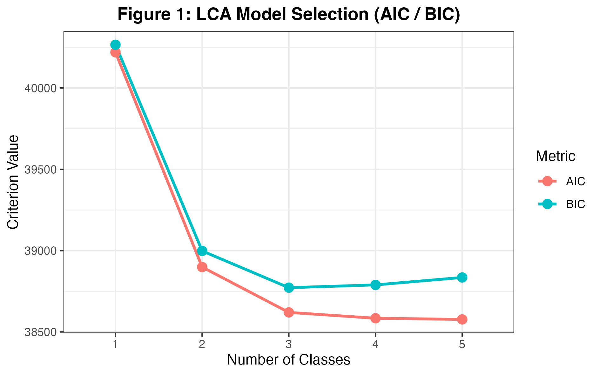
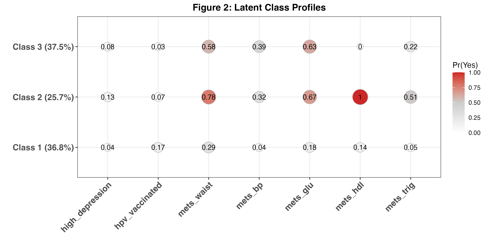

## Introduction

Human papillomavirus (HPV) vaccination is an effective strategy for
preventing new HPV infections and HPV-associated cancers. In the United
States, catch-up vaccination is recommended for all persons through age
26 years, whereas vaccination for adults aged 27--45 years is based on
shared clinical decision-making; HPV vaccines are not licensed for use
after age 45 years [@CDC2024; @meites2019human]. These boundaries make
age particularly relevant when adult vaccination patterns are examined.
Nevertheless, HPV-vaccination coverage among U.S. adults remains
incomplete and varies across demographic and health-care-access groups
[@lewis2022disparities; @lu2021surveillance]. HPV vaccination may
therefore reflect not only receipt of a specific cancer-prevention
intervention but also broader differences in access to and engagement
with preventive care.

Metabolic syndrome (MetS) is a cluster of five cardiometabolic
abnormalities: central adiposity, elevated triglycerides, reduced
high-density lipoprotein cholesterol, elevated blood pressure, and
impaired glucose regulation [@alberti2009harmonizing]. MetS is common
among U.S. adults, increases markedly with age, and is associated with
elevated cardiovascular and all-cause mortality risk
[@hirode2020trends; @mottillo2010metabolic]. Although MetS is
conventionally defined by the presence of any three of its five
components, a binary diagnosis treats individuals with different
constellations of abnormalities as equivalent
[@alberti2009harmonizing]. Retaining the individual components may
therefore provide a more informative account of heterogeneity in
cardiometabolic risk.

Depressive symptoms add a clinically important mental-health dimension
to this heterogeneity. Meta-analytic evidence supports an association
between depression and MetS, including evidence that the relationship
may be bidirectional and that individual MetS components differ in
their associations with depressive symptoms [@kim2023association;
@pan2012bidirectional]. However, research on HPV vaccination,
depressive symptoms, and metabolic health has largely developed along
separate lines. Evidence directly addressing depressive symptoms in
relation to adult HPV-vaccination patterns is limited. The closest
related NHANES research evaluated MetS in relation to HPV infection
rather than vaccination and represented MetS primarily as an overall
diagnosis [@molokwu2017association]. Consequently, little is known about
whether HPV vaccination, depressive symptoms, and component-specific
metabolic abnormalities form distinct patterns within the adult
population.

Latent class analysis (LCA) provides a person-centered approach to this
question by identifying unobserved subgroups whose members share
similar response patterns across multiple indicators. Prior
cancer-prevention research has used LCA to show that health behaviors
and risk conditions cluster within population subgroups in ways that
may be obscured when each factor is examined separately
[@kang2014latent]. Applying LCA to HPV vaccination, depressive symptoms,
and the five MetS components may therefore identify multidomain
prevention profiles that are not captured by a binary MetS diagnosis or
by a series of variable-centered associations.

Accordingly, this study used NHANES 2011–2018 data from U.S. adults aged
20–59 years to identify latent classes defined by HPV vaccine initiation,
elevated depressive symptoms, and the five MetS components, and to describe
their conditional response probabilities and assigned-class proportions.
Age, sex, education, and marital status were summarized descriptively across
the assigned classes. The analysis examines patterns of co-occurrence;
it does not establish causal pathways or developmental trajectories.

## Methods

**Descriptive analyses.** Participant characteristics were summarized as unweighted counts and percentages and survey-weighted percentages. Weighted percentages were calculated using the adjusted fasting-subsample weights for the combined 2011–2018 cycles. The NHANES masked variance strata and primary sampling units were specified to account for the survey's stratified, clustered design [@chen2020nhanes; @lumley2004survey; @nchs2018guidelines]. Survey weights and design variables were used only for the overall descriptive estimates; the latent class models and class summaries were unweighted.

**Latent class analysis.** Exploratory latent class analysis (LCA) was performed using seven binary indicators: initiation of HPV vaccination, elevated depressive symptoms, elevated waist circumference, elevated blood pressure, elevated fasting glucose, low high-density lipoprotein cholesterol, and elevated triglycerides. The models estimated class prevalence and class-specific conditional response probabilities under the assumption of local independence of the indicators within classes [@linzer2011polca; @sinha2021guide]. One- through five-class models were fitted by maximum likelihood using `poLCA` in R. Each model was estimated with 10 alternative starts and then re-estimated with 10 repetitions, including the best starting probabilities from the first stage. The number of classes was evaluated using the Bayesian information criterion (BIC), Akaike information criterion (AIC), normalized entropy, class sizes, average posterior classification probabilities, and substantive interpretability; BIC and interpretability were emphasized in selecting a parsimonious solution [@nylund2007classes; @weller2020bestpractice; @zhou2023latent].

Each participant was assigned to the class with the highest posterior probability. Classes were characterized and labeled using the conditional response probabilities of the seven indicators. Local independence was assessed using pairwise Pearson bivariate residuals, calculated by comparing observed indicator-pair frequencies with those implied by the fitted model; values exceeding 3.84 were flagged for further examination rather than treated as a stand-alone model-selection criterion [@oberski2016dependence].

**Class characterization.** Class labels summarize the model-estimated response probabilities. Demographic characteristics and the seven indicators were also summarized using unweighted percentages within the assigned classes.

## Analysis and Results

### Study Design and Data Source

This cross-sectional study used publicly available data from four consecutive cycles of the National Health and Nutrition Examination Survey (NHANES): 2011–2012, 2013–2014, 2015–2016, and 2017–2018. NHANES is conducted by the National Center for Health Statistics (NCHS) and uses a complex, multistage probability design to produce estimates for the civilian, noninstitutionalized U.S. population [@chen2020nhanes; @nchs2018guidelines]. The survey combines household interviews with standardized examinations and laboratory assessments conducted in mobile examination centers.

The cleaned data set included 5,731 adults aged 20–59 years with complete data on the study variables. Because fasting glucose and triglycerides were included as latent-class indicators, the primary analytic sample was restricted to participants with a positive adjusted fasting-subsample weight (`wtsaf2yrad > 0`), as recommended for analyses that use fasting-subsample measures. This restriction excluded 224 participants and yielded a primary sample of 5,507.

The NHANES protocols were approved by the National Center for Health Statistics Ethics Review Board, and written informed consent was obtained from all adult participants. The present study was a secondary analysis of deidentified public-use data.

### Measures

**HPV Vaccination.** HPV-vaccination status was derived from the NHANES immunization questionnaire. In the analytic sample of adults aged 20–59 years, this measure recorded whether participants had ever received at least one HPV vaccine dose. The cleaned analytic variable was dichotomized as yes versus no. This measure therefore represents initiation of HPV vaccination rather than completion of the recommended vaccine series [@nchs2020immunization; @lewis2022disparities].

**Depressive Symptoms.** Depressive symptoms were assessed with the nine-item Patient Health Questionnaire (PHQ-9), which asks about the frequency of depressive symptoms during the preceding two weeks. Items are scored from 0 to 3 and summed to produce a total score ranging from 0 to 27. Consistent with the established validation study and the coding in the analytic data set, high depressive symptoms were defined as a PHQ-9 score of 10 or higher [@kroenke2001phq9; @nchs2020depression].

**Metabolic Syndrome Components.** Five binary metabolic syndrome (MetS) indicators were included: elevated waist circumference, elevated triglycerides, low high-density lipoprotein cholesterol, elevated blood pressure, and elevated fasting glucose. These indicators correspond to the harmonized MetS framework, under which MetS is defined by the presence of any three or more of the five components [@alberti2009harmonizing].

The reference criteria for the five components are elevated waist circumference (at least 102 cm in men or 88 cm in women when using the U.S. cutoffs); triglycerides of at least 150 mg/dL or relevant treatment; HDL cholesterol below 40 mg/dL in men or 50 mg/dL in women or relevant treatment; systolic blood pressure of at least 130 mm Hg, diastolic blood pressure of at least 85 mm Hg, or antihypertensive treatment; and fasting glucose of at least 100 mg/dL or glucose-lowering treatment [@alberti2009harmonizing]. The analysis used preconstructed indicators from the cleaned file. The upstream implementation of these thresholds and medication rules still requires verification.

**Sociodemographic Characteristics.** Age was grouped into 20–26, 27–45, and 46–59 years. These categories correspond to HPV-vaccination policy boundaries: catch-up vaccination is recommended through age 26, shared clinical decision-making applies to some adults aged 27–45 years, and HPV vaccines are not licensed for adults older than 45 years [@meites2019human]. Because the data were collected during 2011–2018 and the shared clinical decision-making recommendation was adopted in 2019, these categories were treated as current policy-relevant strata rather than historical eligibility categories [@meites2019human].

Sex/gender was coded as female or male based on the NHANES demographic variable. Educational attainment was collapsed into high school or less versus some college or more. Marital status was categorized as married or living with a partner versus never married or previously married. The underlying variables were obtained from the NHANES demographic files [@nchs2020demographics].

### Exploratory Data Analysis

The analytic sample was 53.2% female before weighting and 51.8% female after
weighting. Survey-weighted percentages were 17.5% for ages 20–26, 45.7%
for ages 27–45, and 36.8% for ages 46–59. Some college education or more
was reported by 64.2%, and 63.0% were married or partnered.

HPV vaccine initiation was reported by 9.9% in weighted estimates, and
7.2% had elevated depressive symptoms. Elevated waist circumference
(53.3%) and fasting glucose (46.4%) were the most common metabolic
indicators, followed by low HDL (28.4%), elevated triglycerides (22.5%),
and elevated blood pressure (21.8%). See @tbl-participants for the weighted and unweighted summaries.

| Characteristic | Unweighted n | Unweighted % | Survey-weighted % |
| --- | --- | --- | --- |
| **Age group** |  |  |  |
| 20–26 years | 898 | 16.3 | 17.5 |
| 27–45 years | 2,597 | 47.2 | 45.7 |
| 46–59 years | 2,012 | 36.5 | 36.8 |
| **Sex** |  |  |  |
| Female | 2,927 | 53.2 | 51.8 |
| Male | 2,580 | 46.8 | 48.2 |
| **Education level** |  |  |  |
| High school or less | 2,213 | 40.2 | 35.8 |
| Some college or more | 3,294 | 59.8 | 64.2 |
| **Marital status** |  |  |  |
| Married/Partnered | 3,319 | 60.3 | 63.0 |
| Never/Previously Married | 2,188 | 39.7 | 37.0 |
| **Elevated depressive symptoms** |  |  |  |
| Yes | 428 | 7.8 | 7.2 |
| No | 5,079 | 92.2 | 92.8 |
| **HPV vaccine initiation** |  |  |  |
| Yes | 502 | 9.1 | 9.9 |
| No | 5,005 | 90.9 | 90.1 |
| **Elevated waist circumference** |  |  |  |
| Yes | 2,862 | 52.0 | 53.3 |
| No | 2,645 | 48.0 | 46.7 |
| **Elevated blood pressure** |  |  |  |
| Yes | 1,316 | 23.9 | 21.8 |
| No | 4,191 | 76.1 | 78.2 |
| **Elevated fasting glucose** |  |  |  |
| Yes | 2,604 | 47.3 | 46.4 |
| No | 2,903 | 52.7 | 53.6 |
| **Low HDL cholesterol** |  |  |  |
| Yes | 1,623 | 29.5 | 28.4 |
| No | 3,884 | 70.5 | 71.6 |
| **Elevated triglycerides** |  |  |  |
| Yes | 1,233 | 22.4 | 22.5 |
| No | 4,274 | 77.6 | 77.5 |

: Participant characteristics (N = 5,507). {#tbl-participants}

*Note.* Counts are unweighted. Weighted percentages account for the survey
strata, clusters, and adjusted fasting weights; unweighted percentages
describe the analytic sample. Percentages may not sum to 100 because of
rounding.

### Model Selection

The three-class model had the lowest BIC (38,772.32), with AIC 38,620.20
and entropy 0.659. Although four- and five-class solutions had lower AIC,
their BIC values were higher and their smallest assigned groups were
approximately 5% of the sample. The three-class solution was retained
on the basis of BIC, group sizes, and interpretability (see @tbl-fit and @fig-selection). Its entropy was
the highest among the fitted multiclass solutions, but does not indicate
perfect classification.

| Classes | AIC | BIC | Entropy | Smallest assigned class (%) |
| --- | --- | --- | --- | --- |
| 1 | 40,219.69 | 40,265.99 | — | 100.00 |
| 2 | 38,898.94 | 38,998.15 | 0.482 | 38.99 |
| 3 | 38,620.20 | 38,772.32 | 0.659 | 25.68 |
| 4 | 38,584.37 | 38,789.39 | 0.642 | 4.90 |
| 5 | 38,577.18 | 38,835.11 | 0.562 | 5.01 |

: Fit statistics for the one- through five-class models. {#tbl-fit}

*Note.* All fit statistics are from unweighted models. The one-class
entropy entry is not applicable: the v6 export stores 1 by convention,
but normalized classification entropy is not informative for a single
class. Smallest-class percentages are based on modal assignments.

{#fig-selection fig-alt="AIC continues to decrease through five classes; BIC is lowest at three classes."}

### Model Diagnostics

Mean posterior membership probabilities for the assigned classes were
0.779, 0.908, and 0.825. Class 1 had the greatest remaining classification
uncertainty: its members had an average probability of 0.199 for Class 3.
Modal assignments should therefore be treated as uncertain summaries.

| Assigned class | Posterior: Class 1 | Posterior: Class 2 | Posterior: Class 3 |
| --- | --- | --- | --- |
| Assigned Class 1 | 0.779 | 0.022 | 0.199 |
| Assigned Class 2 | 0.092 | 0.908 | &lt;0.001 |
| Assigned Class 3 | 0.175 | &lt;0.001 | 0.825 |

: Average posterior probabilities by assigned class. {#tbl-posterior}

*Note.* Each row averages all posterior probabilities among participants
assigned to that row's class. The diagonal is the mean probability of
the assigned class. Rounding may cause small row-sum discrepancies.

Pairwise BVRs ranged from 0.008 to 4.064. HPV vaccine initiation and elevated
waist circumference were the only pair above the screening value of 3.84
(BVR = 4.064). Most pairwise associations were reproduced reasonably well,
but this remaining association and the extreme HDL probabilities warrant
caution. These diagnostics do not establish that local independence holds
exactly.

| Indicator | Depressive symptoms | HPV | Waist | BP | Glucose | HDL | Triglycerides |
| --- | --- | --- | --- | --- | --- | --- | --- |
| Elevated depressive symptoms | — | — | — | — | — | — | — |
| HPV vaccine initiation | 0.515 | — | — | — | — | — | — |
| Elevated waist circumference | 2.734 | 4.064 | — | — | — | — | — |
| Elevated blood pressure | 2.325 | 1.721 | 1.477 | — | — | — | — |
| Elevated fasting glucose | 0.53 | 2.991 | 1.325 | 0.344 | — | — | — |
| Low HDL cholesterol | 0.073 | 0.787 | 1.764 | 0.008 | 0.082 | — | — |
| Elevated triglycerides | 0.115 | 1.662 | 3.628 | 1.444 | 2.448 | 0.013 | — |

: Pairwise Pearson bivariate residuals for the three-class model (lower triangle). {#tbl-bvr}

*Note.* Values are Pearson statistics, not correlation coefficients or
*p* values. Dashes mark the diagonal and unused upper triangle.

### Latent Class Profiles

Modal posterior assignment produced 2,029 participants in Class 1 (36.8%),
1,414 in Class 2 (25.7%), and 2,064 in Class 3 (37.5%). These are unweighted
assigned-class proportions. The profiles below are described using the
model's conditional response probabilities, which differ from observed
percentages in the assigned groups (@tbl-probabilities and @fig-profiles).

| Indicator | Class 1 | Class 2 | Class 3 |
| --- | --- | --- | --- |
| Elevated depressive symptoms | 0.041 | 0.133 | 0.079 |
| HPV vaccine initiation | 0.170 | 0.068 | 0.028 |
| Elevated waist circumference | 0.289 | 0.780 | 0.583 |
| Elevated blood pressure | 0.036 | 0.319 | 0.388 |
| Elevated fasting glucose | 0.182 | 0.673 | 0.633 |
| Low HDL cholesterol | 0.142 | 1.000 | 0.000 |
| Elevated triglycerides | 0.048 | 0.511 | 0.215 |

: Class-specific conditional probabilities of a positive indicator response. {#tbl-probabilities}

*Note.* Values are model-estimated probabilities, rounded to three decimal
places. Estimates displayed as 0.000 or 1.000 do not prove that the
corresponding probability is exactly zero or one in the population.

{#fig-profiles fig-alt="Three class profiles across seven indicators, showing low HDL concentrated in Class 2 and elevated blood pressure most probable in Class 3."}

#### Class 1: Relatively Lower Metabolic Burden

Class 1 had the lowest probabilities of elevated blood pressure (0.036),
fasting glucose (0.182), triglycerides (0.048), and depressive symptoms
(0.041). Its HPV vaccine initiation probability was comparatively higher
(0.170), but vaccination remained uncommon. Elevated waist circumference
still had a probability of 0.289, so the class should not be interpreted
as free of metabolic abnormalities.

#### Class 2: Lipid-related and Multicomponent Metabolic Burden

Class 2 had the highest probabilities of low HDL (1.000), elevated waist
circumference (0.780), fasting glucose (0.673), and triglycerides (0.511).
The probability of elevated depressive symptoms was also highest (0.133),
while HPV vaccine initiation was 0.068. The label describes a relative
pattern; most members were not estimated to have elevated depressive
symptoms.

#### Class 3: Blood Pressure and Glucose Burden with Low HPV Vaccination

Class 3 had the highest probability of elevated blood pressure (0.388),
with prominent elevated fasting glucose (0.633) and waist circumference
(0.583). Low HDL had an estimated probability of 0.000, distinguishing
this class from Class 2. HPV vaccine initiation was lowest (0.028), and
elevated depressive symptoms had a probability of 0.079. The different
lipid and blood-pressure patterns make a single low-to-high risk ranking
of the classes incomplete.

### Descriptive Characteristics of Assigned Classes

Class 1 was younger and more highly educated: 29% were aged 20–26, 61%
were female, and 69% reported some college education or more. Class 2
was 58% female, with 46% reporting high school education or less. Class 3
was older and more male-predominant: 50% were aged 46–59 and 58% were male.
These are descriptive comparisons of assigned groups, not adjusted
associations or tests of demographic predictors.

| Characteristic | Class 1: n = 2,029 (36.8%) | Class 2: n = 1,414 (25.7%) | Class 3: n = 2,064 (37.5%) |
| --- | --- | --- | --- |
| **Age group, %** |  |  |  |
| 20–26 years | 29% | 11% | 7.3% |
| 27–45 years | 50% | 50% | 42% |
| 46–59 years | 21% | 39% | 50% |
| **Sex, %** |  |  |  |
| Female | 61% | 58% | 42% |
| Male | 39% | 42% | 58% |
| **Education level, %** |  |  |  |
| High school or less | 31% | 46% | 45% |
| Some college or more | 69% | 54% | 55% |
| **Marital status, %** |  |  |  |
| Married/Partnered | 56% | 63% | 63% |
| Never/Previously Married | 44% | 37% | 37% |
| **Elevated depressive symptoms, %** |  |  |  |
| Yes | 3.4% | 13% | 8.9% |
| No | 97% | 87% | 91% |
| **HPV vaccine initiation, %** |  |  |  |
| Yes | 19% | 5.7% | 1.7% |
| No | 81% | 94% | 98% |
| **Elevated waist circumference, %** |  |  |  |
| Yes | 30% | 78% | 56% |
| No | 70% | 22% | 44% |
| **Elevated blood pressure, %** |  |  |  |
| Yes | 0.4% | 31% | 42% |
| No | 100% | 69% | 58% |
| **Elevated fasting glucose, %** |  |  |  |
| Yes | 3.3% | 66% | 78% |
| No | 97% | 34% | 22% |
| **Low HDL cholesterol, %** |  |  |  |
| Yes | 10% | 100% | 0% |
| No | 90% | 0% | 100% |
| **Elevated triglycerides, %** |  |  |  |
| Yes | 4.3% | 49% | 22% |
| No | 96% | 51% | 78% |

: Observed characteristics within assigned classes (unweighted percentages). {#tbl-class-characteristics}

*Note.* Percentages are unweighted and rounded as in the v6 export;
complements may not sum exactly to 100%. These observed percentages can
differ substantially from the model-estimated probabilities in
@tbl-probabilities because modal assignment conditions on the response
patterns.

## Conclusion

### Main Findings and Interpretation

The analysis identified three interpretable profiles across HPV vaccine
initiation, depressive symptoms, and five MetS components. One profile
had relatively lower metabolic burden and comparatively higher vaccine
initiation. A second combined low HDL with several metabolic abnormalities
and a relatively higher probability of depressive symptoms. A third was
distinguished by blood pressure and glucose abnormalities, little low HDL,
and very low vaccine initiation.

These results describe heterogeneity in how measured health characteristics
co-occur. They illustrate why separate metabolic components can provide
useful detail when describing health profiles. The analysis does not
establish that this representation predicts outcomes better than a binary
MetS diagnosis. The depression–MetS literature motivates studying both
health domains together [@kim2023association; @pan2012bidirectional],
while prior cancer-risk LCA provides a precedent for examining patterns
across multiple indicators [@kang2014latent]. Neither line of evidence
validates the exact classes estimated here.

### Limitations and Future Work

NHANES is cross-sectional, so temporal order and causal mechanisms cannot
be inferred. Vaccination was self-reported and indicates initiation rather
than completion. Complete-data selection and the positive fasting-weight
restriction may affect who is represented. Earlier exclusions and the
construction of the supplied metabolic flags, including medication
handling, require a complete preprocessing audit.

Only overall descriptive percentages used the NHANES survey design.
The unweighted LCA and assigned-class summaries should not be interpreted
as nationally representative class prevalence. Classification was imperfect
(entropy 0.659), one indicator pair retained a flagged residual association,
and the rounded HDL probabilities reached boundary values. Repeated-start
likelihood records and broader reproducibility checks are needed before
claiming a globally optimal or fully stable solution. Descriptive
comparisons across assigned classes do not propagate classification
uncertainty.

Future work should document the original data-cleaning pathway, examine
the model's remaining dependence and boundary estimates, and assess
whether the profiles are reproducible in an independent sample. The
present findings support a descriptive account of distinct health
profiles rather than clinical diagnoses or causal claims.

## References

::: {#refs}
:::
